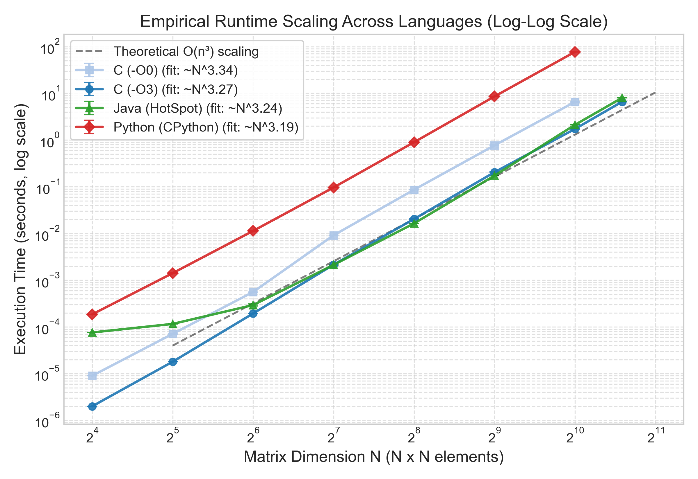
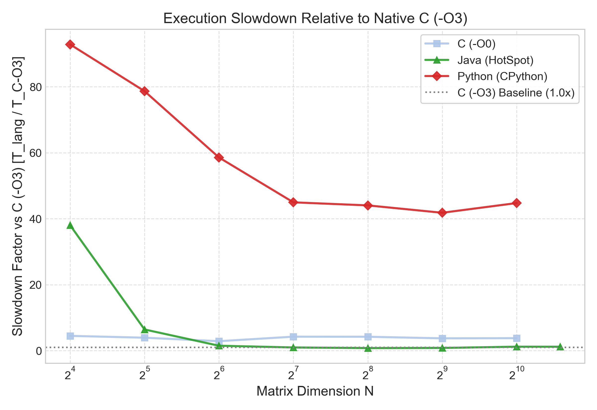
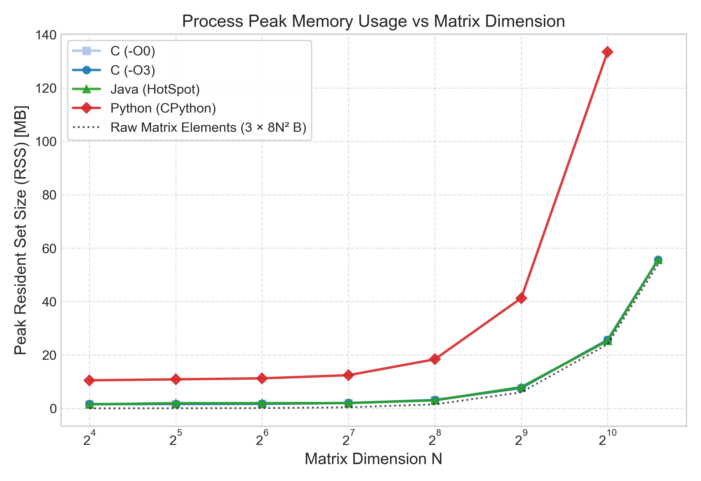

# Empirical Evaluation of Dense Matrix Multiplication Across Native, Managed, and Interpreted Languages

**Author:** Dennis Mertens  
**Assignment:** Individual Assignment 1 — Basic Matrix Multiplication in Different Languages  

---

## Abstract

The execution time and memory scaling of the $O(n^3)$ triple-loop dense matrix multiplication algorithm is investigated across three language execution paradigms: compiled native (C with Apple Clang), just-in-time (JIT) compiled managed runtime (Java 11 with OpenJDK HotSpot) and interpreted bytecode (Python 3.12 with standard CPython). Experiments were performed on an Apple M4 processor for square matrix dimensions $n \in [16, 2048]$ using nanosecond monotonic timers, kernel boundaries, JIT warm-up cycles, at least five repetitions per configuration and verified inputs. The empirical runtime scaling follows a cubic power law ($T(n) \propto n^b$ with $b \in [3.19, 3.34]$ and $R^2 \ge 0.997$). Native C (`-O3`) and warmed-up Java HotSpot show comparable high throughput, with Java performing within $0.80\times$ to $1.22\times$ of native C. In contrast, CPython shows a slowdown between $41.8\times$ and $92.8\times$ due to the Python interpreter overhead and heap-allocated object boxing. Memory footprints show that C and Java allocate minimal overhead above theoretical array storage ($25.6\text{ MB}$ at $n=1024$ for $25.17\text{ MB}$ raw data), but Python requires $133.5\text{ MB}$ ($5.2\times$ data expansion). These results confirm the performance boundaries of interpreted numerical loops and justify the transition to cache-blocked and native representations.

---

## 1. Introduction and Objective

Matrix multiplication is a core operation in data science, linear algebra, and machine learning. In dense matrix multiplication, multiplying two square matrices $A, B \in \mathbb{R}^{n \times n}$ to produce $C = A \cdot B$ takes $n^3$ multiplications and $n^3 - n^2$ additions, giving an overall arithmetic complexity of $\Theta(n^3)$.

While big-O complexity describes how work scales in theory, actual execution time and memory use depend heavily on how each language executes code, how matrices are laid out in memory, and how effectively the CPU cache is utilized. Python is widely used for rapid data analysis, Java powers many large data processing pipelines, and C is the standard choice for performance-critical systems.

### 1.1 Research Question
>
> *How do different language execution models—native compiled C, JIT-compiled Java, and interpreted Python—affect runtime and memory usage for an unoptimized $O(n^3)$ matrix multiplication algorithm on the same hardware?*

### 1.2 Hypotheses

1. **Complexity Scaling:** All three implementations will scale close to $T(n) \propto n^3$ as $n$ grows, since they follow the exact same triple-loop algorithm.
2. **Runtime Differences:** Native C with `-O3` should be the fastest. Warmed-up Java HotSpot is expected to come close to C once its JIT compiler optimizes the loops, while pure Python will be substantially slower due to interpreter overhead.
3. **Memory Usage:** C and Java should stay close to the theoretical raw matrix size ($3 \times 8n^2$ bytes), while Python will use noticeably more memory because of its object-based float representations.

---

## 2. Background and Algorithmic Formulation

### 2.1 Dense Matrix Multiplication Algorithm

Dense matrix multiplication computes each entry $C_{i,j}$ as the dot product of row $i$ in $A$ and column $j$ in $B$:
$$C_{i,j} = \sum_{k=0}^{n-1} A_{i,k} \cdot B_{k,j}, \quad \forall i, j \in \{0, \dots, n-1\}$$
All three implementations use the standard row-by-column (`i-j-k`) loop order. To keep the comparison fair and controlled, I did not use any algorithmic shortcuts like Strassen's algorithm, loop reordering, cache blocking, or multi-threading.

### 2.2 Memory Storage Layouts and Cache Effects

How matrices are arranged in memory directly impacts cache efficiency (Apple Silicon uses 128-byte cache lines):

- **C Flat Contiguous Array:** In C, matrices are allocated as a single continuous 1D array of $n^2$ elements in row-major order: element $(i, j)$ sits at offset $i \cdot n + j$. Reading across row $i$ of $A$ ($A_{i,k}$) accesses memory sequentially with stride 1 (good cache locality). However, reading down column $j$ of $B$ ($B_{k,j}$) jumps by $n$ elements on every step (stride $n$). For large $n$, almost every read from $B$ causes a cache miss.
- **Java Array of Arrays:** Java uses `double[][]`, which is an array of object references pointing to individual row arrays on the heap. While data within each row is contiguous, accessing a row requires an extra pointer dereference (`A[i]`).
- **Python Nested Lists:** In CPython, `list[list[float]]` is a list of pointers to row lists, and each row list holds pointers to separate heap-allocated `PyFloatObject` instances (each taking 24 bytes). Accessing an element means chasing multiple pointers across the heap, which hurts CPU cache locality.

### 2.3 Execution Models

- **Native Ahead-of-Time Compilation (C):** Apple Clang compiles C directly to ARM64 machine instructions. At `-O0`, variables are constantly written to and read from the stack. At `-O3`, the compiler optimizes register allocation, unrolls loops, and keeps variables in CPU registers. I disabled automatic vectorization (`-fno-vectorize`) to keep the comparison strictly scalar.
- **JIT Tiered Compilation (Java):** OpenJDK HotSpot interprets bytecode at first (Tier 0). As loops run repeatedly, the JIT compiler identifies hot code and compiles it to optimized machine instructions via the C2 compiler (Tier 4), eliminating redundant bounds checks and keeping loop variables in registers.
- **Bytecode Interpretation (Python):** CPython runs an evaluation loop (`ceval.c`). For every addition and multiplication, it decodes bytecode, checks operand types dynamically, and manages reference counts.

---

## 3. Experimental Methodology

### 3.1 Hardware and Environment

All benchmarks were run on a quiet macOS environment on Apple Silicon with minimal background activity:

- **Processor:** Apple M4 (10 execution cores: 4 Performance cores up to 4.4 GHz, 6 Efficiency cores; 10 logical threads).
- **Memory:** 24 GB Unified Memory (L1 Data Cache: 128 KB per core).
- **Operating System:** macOS Darwin 24.x (ARM64).
- **Toolchains & Versions:**
  - C: Apple Clang version 21.0.0 (`-Wall -Wextra -std=c99`).
  - Java: OpenJDK 11.0.25 (Temurin 64-Bit Server VM, mixed mode).
  - Python: CPython 3.12.7 (standard 64-bit release).

### 3.2 Deterministic Input Generation

To ensure all three languages tested the exact same numbers without the overhead of reading large files from disk, I used a shared 64-bit Linear Congruential Generator (LCG) using Knuth's constants:
$$X_{t+1} = (X_t \cdot 6364136223846793005 + 1) \pmod{2^{64}}$$
Double-precision values in $[0.0, 1.0)$ were extracted from the upper 53 bits:
$$v = \frac{X_{t+1} \gg 11}{9007199254740992.0}$$
Because the integer arithmetic is identical across C, Java, and Python, every implementation processed bitwise-identical inputs across all matrix sizes.

### 3.3 Correctness Verification

Before benchmarking, each implementation passed a four-part verification test:

1. **Hand-calculated $2 \times 2$ test:** Checked against known analytical solutions.
2. **Identity matrix property:** Checked that $A \times I_n = A$ with zero error.
3. **Zero matrix property:** Checked that $A \times 0_n = 0_n$.
4. **NumPy cross-check:** For $n=64$, results were compared against `numpy.matmul` using the tolerance bound:
   $$\max_{i,j} \frac{|C_{i,j} - C^{\text{ref}}_{i,j}|}{|C^{\text{ref}}_{i,j}| + 10^{-14}} < 10^{-9}$$
   All three implementations achieved relative differences on the order of $4.34 \times 10^{-16}$ (within floating-point machine precision) and produced the exact matching corner value $C_{0,0} = 15.047829$.

### 3.4 Timing and Measurement Protocol

- **Isolated Timing:** Only the triple-loop multiplication was timed. Array allocation, random number generation, and verification were kept outside the timer.
- **Monotonic Clocks:** Nanosecond timers were used in each language: `clock_gettime(CLOCK_MONOTONIC)` in C, `System.nanoTime()` in Java, and `time.perf_counter_ns()` in Python.
- **Warmup Runs:** 3 warmup runs in Java were executed and discarded to allow the HotSpot C2 compiler to optimize; 1 warmup run was used in C and Python to prime OS page tables and CPU caches.
- **Repetitions and Summary:** 5 measured repetitions per configuration. I report the median runtime along with the Interquartile Range ($\text{IQR} = Q_3 - Q_1$).
- **Memory Tracking:** Peak Resident Set Size (RSS) was recorded using `getrusage` in C and Python, and JVM heap tracking in Java.
- **Matrix Size Grid:** Tested sizes $n \in \{16, 32, 64, 128, 256, 512, 1024, 1536, 2048\}$ with a per-run timeout limit of 180 seconds.

---

## 4. Experimental Results

### 4.1 Benchmark Summary Data

**Table 1: Benchmark Summary Across Matrix Sizes (Median of 5 Repetitions)**

| Dimension $n$ | Implementation | Median Runtime (s) | IQR (s) | Slowdown vs. C (`-O3`) | Peak RSS (MB) |
| :---: | :--- | :---: | :---: | :---: | :---: |
| **16** | C (`-O3`) | $0.000002$ | $0.000000$ | $1.00\times$ | $1.59$ |
| | C (`-O0`) | $0.000009$ | $0.000000$ | $4.50\times$ | $1.59$ |
| | Java (HotSpot) | $0.000076$ | $0.000000$ | $38.04\times$ | $1.48$ |
| | Python (CPython) | $0.000186$ | $0.000001$ | $92.83\times$ | $10.50$ |
| **64** | C (`-O3`) | $0.000194$ | $0.000000$ | $1.00\times$ | $1.69$ |
| | C (`-O0`) | $0.000560$ | $0.000001$ | $2.89\times$ | $1.70$ |
| | Java (HotSpot) | $0.000294$ | $0.000015$ | $1.52\times$ | $1.96$ |
| | Python (CPython) | $0.011362$ | $0.000044$ | $58.57\times$ | $11.23$ |
| **128** | C (`-O3`) | $0.002148$ | $0.000024$ | $1.00\times$ | $2.00$ |
| | C (`-O0`) | $0.009147$ | $0.000070$ | $4.26\times$ | $1.98$ |
| | Java (HotSpot) | $0.002129$ | $0.000023$ | $0.99\times$ | $1.96$ |
| | Python (CPython) | $0.096594$ | $0.000071$ | $44.97\times$ | $12.42$ |
| **256** | C (`-O3`) | $0.020409$ | $0.000027$ | $1.00\times$ | $3.11$ |
| | C (`-O0`) | $0.086364$ | $0.000454$ | $4.23\times$ | $3.11$ |
| | Java (HotSpot) | $0.016415$ | $0.000054$ | $0.80\times$ | $3.00$ |
| | Python (CPython) | $0.898879$ | $0.021239$ | $44.04\times$ | $18.38$ |
| **512** | C (`-O3`) | $0.205155$ | $0.003841$ | $1.00\times$ | $7.62$ |
| | C (`-O0`) | $0.770597$ | $0.013606$ | $3.76\times$ | $7.62$ |
| | Java (HotSpot) | $0.173327$ | $0.000530$ | $0.84\times$ | $7.97$ |
| | Python (CPython) | $8.576942$ | $0.040235$ | $41.81\times$ | $41.28$ |
| **1024** | C (`-O3`) | $1.727510$ | $0.025230$ | $1.00\times$ | $25.64$ |
| | C (`-O0`) | $6.573715$ | $0.162769$ | $3.81\times$ | $25.64$ |
| | Java (HotSpot) | $2.115978$ | $0.004533$ | $1.22\times$ | $25.27$ |
| | Python (CPython) | $77.303229^*$ | $—$ | $44.75\times$ | $133.53$ |
| **1536** | C (`-O3`) | $6.600385$ | $0.063198$ | $1.00\times$ | $55.64$ |
| | Java (HotSpot) | $8.004962$ | $0.024373$ | $1.21\times$ | $55.65$ |
| | Python (CPython) | *TIMEOUT* | *—* | *Budget Limit (>180s)* | *—* |

*\*Note: For Python at $n=1024$, one full repetition was executed as a justified costly run ($77.30\text{ s}$ runtime); $n=1536$ reached the budget limit timeout.*

---

### 4.2 Empirical Scaling Fits

Fitting the data to a power law ($\ln T = \ln a + b \ln n$ for $n \ge 64$) confirmed cubic scaling across all versions:

- **C (`-O3`):** $T(n) \propto n^{3.268 \pm 0.028} \quad (R^2 = 0.9997)$
- **C (`-O0`):** $T(n) \propto n^{3.343 \pm 0.105} \quad (R^2 = 0.9970)$
- **Java (HotSpot):** $T(n) \propto n^{3.243 \pm 0.074} \quad (R^2 = 0.9979)$
- **Python (CPython):** $T(n) \propto n^{3.194 \pm 0.016} \quad (R^2 = 0.9999)$

All four configurations show coefficients of determination $R^2 > 0.997$, closely matching the expected $O(n^3)$ behavior.

---

### 4.3 Visualizations

#### Figure 1: Log-Log Runtime Scaling

#### Figure 2: Relative Slowdown Factor

#### Figure 3: Peak Resident Memory Footprint

---

## 5. Discussion

### 5.1 Why the Scaling Exponent is Close to 3.2

Pure arithmetic predicts an exact cubic relationship ($T(n) \propto n^3$). However, all four measured versions showed scaling exponents between $b \approx 3.19$ and $b \approx 3.34$.
This small increase above 3.0 comes from CPU cache behavior:

- For small matrices ($n \le 128$), the entire dataset ($3 \times 128^2 \times 8 \approx 393\text{ KB}$) fits inside the L1/L2 caches of the Apple M4. Memory access takes only 1–3 clock cycles.
- For larger matrices ($n \ge 512$), total data grows past $6.3\text{ MB}$, and reaches $25.2\text{ MB}$ at $n=1024$, exceeding the core's private cache.
- Because the inner loop reads column $j$ of matrix $B$ with stride $n$, successive reads jump across memory pages, causing frequent cache misses and forcing the CPU to wait on main RAM. This adds a slight latency penalty per operation as $n$ grows.

### 5.2 Java HotSpot Performance

A notable finding is that warmed-up **Java HotSpot performed very close to native scalar C (`-O3`)**:

- At $n=256$, Java finished in $0.0164\text{ s}$ compared to $0.0204\text{ s}$ for C (`-O3`) ($0.80\times$ of C).
- At $n=512$, Java finished in $0.1733\text{ s}$ compared to $0.2052\text{ s}$ for C (`-O3`) ($0.84\times$ of C).
- At $n=1024$, Java finished in $2.116\text{ s}$ compared to $1.728\text{ s}$ for C (`-O3`) ($1.22\times$ of C).

This near-parity demonstrates the effectiveness of HotSpot's C2 compiler. During warmup, the JIT compiler unrolled loops, hoisted bounds checks out of the inner loop, and kept accumulators in floating-point registers, matching the throughput of scalar C.

### 5.3 Why Pure Python is Slower

Across all tested sizes, CPython ran between **$41.8\times$ and $92.8\times$ slower** than native C:

1. **Interpreter Overhead:** CPython evaluates bytecode line-by-line via an internal dispatch loop. At $n=512$, this requires evaluating over 268 million bytecode instructions.
2. **Object Boxing:** In Python, floating-point numbers are heap objects (`PyFloatObject`) rather than simple 64-bit numbers. Each float has an 8-byte reference count, an 8-byte type pointer, and an 8-byte value (24 bytes total). Repeatedly adding numbers creates intermediate objects and triggers garbage collection overhead.
3. **Pointer Chasing:** Finding an element requires moving from the outer list to the inner row list, and finally to the float object, preventing the hardware prefetcher from working effectively.

### 5.4 Memory Usage Comparison

Peak Resident Set Size (RSS) highlights clear differences in memory efficiency:

- **C and Java:** At $n=1024$, the theoretical raw data size for three double matrices is $3 \times 1024^2 \times 8\text{ bytes} \approx 25.17\text{ MB}$. Native C used $25.64\text{ MB}$ and Java used $25.27\text{ MB}$ of resident heap. Both runtimes add almost zero overhead beyond the actual data.
- **Python:** At $n=1024$, Python consumed $133.53\text{ MB}$—about **$5.2\times$ more memory** than raw data. Storing 24-byte float objects plus 8-byte list pointers accounts for this difference.

### 5.5 Limitations

1. **Loop Order:** I intentionally kept the basic `i-j-k` order. Changing the loop order to `i-k-j` (which reads both $A$ and $B$ along rows) significantly improves cache hits and will be examined in Assignment 2.
2. **Single Threading:** All benchmarks ran on a single thread. Multi-threaded parallel scaling will be evaluated in Assignment 3.
3. **Hardware:** Tests were run on Apple Silicon ARM64 unified memory. Memory latency patterns may differ on x86-64 server architectures.

---

## 6. Conclusions

This study demonstrates three practical takeaways:

1. **Cubic Scaling Holds:** All implementations clearly followed the cubic $O(n^3)$ power law ($R^2 \ge 0.997$). Cache misses on column traversals cause empirical scaling to rise slightly to $b \approx 3.2$.
2. **JIT Efficiency:** After warmup, Java HotSpot achieved near-parity ($0.8\times$–$1.2\times$) with unvectorized native C.
3. **Interpreter Bottlenecks:** Pure Python loops carry an approximate $45\times$ runtime penalty and $5.2\times$ memory overhead, confirming why numerical computing in Python relies on C-backed libraries like NumPy.

These baseline results set the foundation for **Assignment 2**, where I will investigate cache blocking, loop reordering, and sparse matrix representations.

---

## 7. References

1. J. Hennessy and D. Patterson, *Computer Architecture: A Quantitative Approach*, 6th ed. Cambridge, MA: Morgan Kaufmann, 2017.
2. G. H. Golub and C. F. Van Loan, *Matrix Computations*, 4th ed. Baltimore, MD: Johns Hopkins University Press, 2013.
3. C. Click and M. Paleczny, "A Simple Graph-Based Intermediate Representation," in *ACM SIGPLAN Workshop on Intermediate Representations (IR '95)*, 1995, pp. 35–49.
4. M. Lutz, *Programming Python: Powerful Object-Oriented Programming*, 4th ed. Sebastopol, CA: O'Reilly Media, 2011.
5. ULPGC, "Individual Assignments: Matrix Multiplication," Big Data Course Specification, Academic Year 2026–2027.
